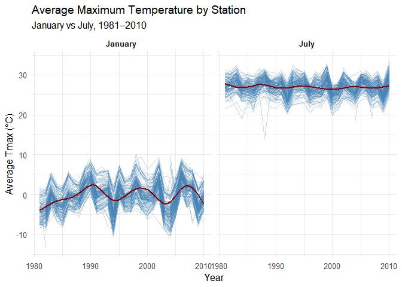
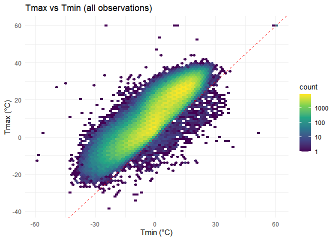
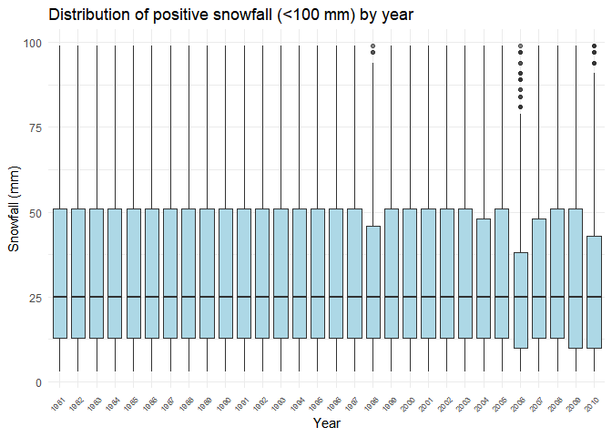
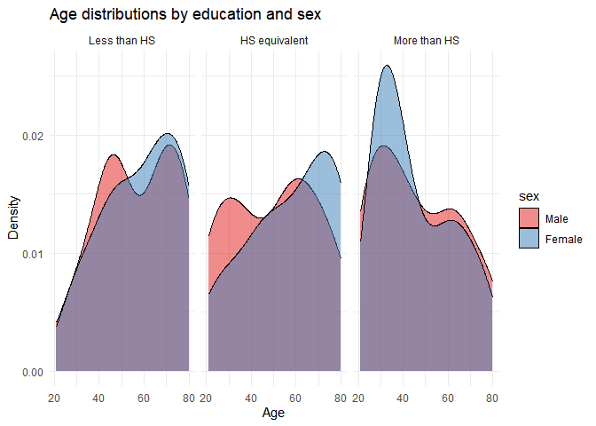
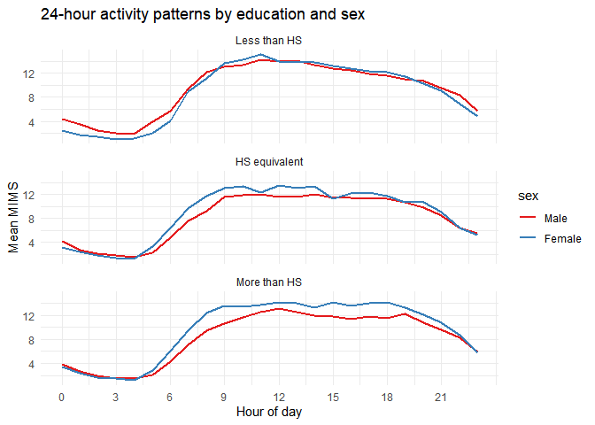
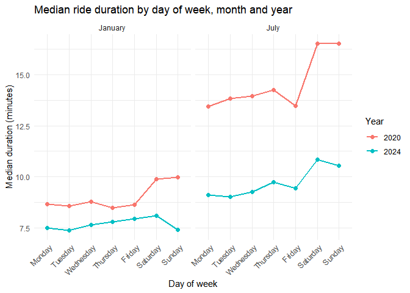

p8105_hw3_zl3804
================
Zhuoxuan Li (Eva)
2026-10-20

# setup

``` r
library(tidyverse)
```

    ## ── Attaching core tidyverse packages ──────────────────────── tidyverse 2.0.0 ──
    ## ✔ dplyr     1.2.1     ✔ readr     2.2.0
    ## ✔ forcats   1.0.1     ✔ stringr   1.6.0
    ## ✔ ggplot2   4.0.3     ✔ tibble    3.3.1
    ## ✔ lubridate 1.9.5     ✔ tidyr     1.3.2
    ## ✔ purrr     1.2.2     
    ## ── Conflicts ────────────────────────────────────────── tidyverse_conflicts() ──
    ## ✖ dplyr::filter() masks stats::filter()
    ## ✖ dplyr::lag()    masks stats::lag()
    ## ℹ Use the conflicted package (<http://conflicted.r-lib.org/>) to force all conflicts to become errors

``` r
library(p8105.datasets)
```

# Problem 1

ny_noaa with 7variables and 2595176 obervations includes daily
observation data in different weather stations in New York over
1981–2010 ,such as weather station id，Precipitation (tenths of
mm)，date，snowfall,snow depth,maximum temperature and minimum
temperature.

The data size is very large and many missing data exist, especially
among tmax and tmin.

``` r
data("ny_noaa")
ny <- ny_noaa

ny_clean = ny |>
  mutate(
    date = as.Date(date),
    year = year(date),
    month = month(date),
    day = day(date),
    prcp_mm = as.numeric(prcp)/ 10,         
    tmax_c = as.numeric(tmax) / 10,          
    tmin_c = as.numeric(tmin) / 10,           
    snow_mm = snow,              
    snwd_mm = snwd
  ) |>
  select(id, date, year, month, day, prcp_mm, snow_mm, snwd_mm, tmax_c, tmin_c)


snow_common = ny_clean |>
  count(snow_mm, sort = TRUE) |>
  head(10)
```

The most common snowfall values are 0 (no snow) and 25mm, 13mm, 51mm,
etc. Zero is by far the most frequent because most days have no
snowfall.

``` r
jan_july <- ny_clean |>
  filter(month == 1 | month == 7, !is.na(tmax_c)) |>
  group_by(id, month, year) |>
  summarise(avg_tmax = mean(tmax_c, na.rm = TRUE), .groups = "drop") |>
  mutate(month_lab = factor(month, levels = c(1, 7), labels = c("January", "July")))

ggplot(jan_july, aes(x = year, y = avg_tmax, group = id)) +
  geom_line(alpha = 0.3, color = "steelblue") +
  geom_smooth(aes(group = 1), se = FALSE, color = "darkred", linewidth = 1) +
  facet_wrap(~ month_lab) +
  labs(
    title = "Average Maximum Temperature by Station",
    subtitle = "January vs July, 1981–2010",
    x = "Year", y = "Average Tmax (°C)"
  ) +
  theme_minimal(base_size = 12) +
  theme(strip.text = element_text(face = "bold"))
```

    ## `geom_smooth()` using method = 'gam' and formula = 'y ~ s(x, bs = "cs")'

<!-- -->

January temperatures show more year-to-year fluctuation and a slight
upward trend at some stations. July temperatures are higher and more
stable. A few stations appear as outliers, one station with unusually
low value around 1987 July and one statioj with very lower tmax around
1982 Jan in particular.

``` r
ggplot(ny_clean |> 
         filter(!is.na(tmax_c), 
                !is.na(tmin_c)), 
       aes(x = tmin_c, y = tmax_c)) +
  geom_hex(bins = 80) +
  scale_fill_viridis_c(trans = "log10") +
  geom_abline(slope = 1, intercept = 0, 
              linetype = "dashed", 
              color = "red") +
  labs(title = "Tmax vs Tmin (all observations)",
       x = "Tmin (°C)", 
       y = "Tmax (°C)") +
  theme_minimal()
```

<!-- -->

``` r
ny_clean |>
  filter(snow_mm > 0, 
         snow_mm < 100) |>
  ggplot(aes(x = factor(year), y = snow_mm)) +
  geom_boxplot(outlier.alpha = 0.2, 
               fill = "lightblue") +
  labs(title = "Distribution of positive snowfall (<100 mm) by year",
       x = "Year", y = "Snowfall (mm)") +
  theme_minimal() +
  theme(axis.text.x = element_text(angle = 45, hjust = 1, size = 7))
```

<!-- --> tmax
and tmin are strongly positively associated. The snowfall distribution
shows that most non-zero snowfalls are modest; extreme values are rare
and the pattern is fairly consistent across years, with some years
having heavier tails, for example, snowfall data in 2006 has heavy upper
tail.

# Problem 2

``` r
covar = read_csv(
  "data/nhanes_covar.csv",
  skip = 4,
  na = c(".", "", "NA"),
  show_col_types = FALSE
) |>
  janitor::clean_names()

accel = read_csv(
  "data/nhanes_accel.csv",
  na = c(".", "", "NA"),
  show_col_types = FALSE
) |>
  janitor::clean_names()


covar_clean = covar |>
  mutate(
    sex = factor(sex, levels = c(1, 2), labels = c("Male", "Female")),
    education = factor(education,
                       levels = c(1, 2, 3),
                       labels = c("Less than HS", "HS equivalent", "More than HS"),
                       ordered = TRUE)
  ) |>
  filter(age >= 21, !is.na(sex), !is.na(education), !is.na(age))

accel_long = accel |>
  pivot_longer(
    cols = starts_with("min"),
    names_to = "minute",
    values_to = "mims",
    names_prefix = "min"
  ) |>
  mutate(minute = as.integer(minute))

nhanes = accel_long |>
  inner_join(covar_clean, by = "seqn")
```

``` r
tab = nhanes |>
  distinct(seqn, sex, education) |>
  count(education, sex) |>
  pivot_wider(names_from = sex, values_from = n, values_fill = 0)

knitr::kable(tab, caption = "Number of men and women by education category")
```

| education     | Male | Female |
|:--------------|-----:|-------:|
| Less than HS  |   28 |     29 |
| HS equivalent |   36 |     23 |
| More than HS  |   56 |     59 |

Number of men and women by education category

There are more participants with “More than high school” education. Sex
balance is reasonably even within each education category, but for high
school equivalent education level, men are more than women.

``` r
nhanes |>
  distinct(seqn, age, sex, education) |>
  ggplot(aes(x = age, fill = sex)) +
  geom_density(alpha = 0.5) +
  facet_wrap(~ education) +
  labs(title = "Age distributions by education and sex",
       x = "Age", y = "Density") +
  theme_minimal() +
  scale_fill_brewer(palette = "Set1")
```

<!-- --> The
density plots show distinct age distributions across education levels.
In the “Less than HS” group, both sexes are concentrated at older ages
(roughly 50–80). In the “HS equivalent” group has a broader, males shows
a secondary peak at younger ages and females are more concentrated in
the 60–80 range. In contrast, the “More than HS” group is dominated by
younger adults, especially females, who exhibit a sharp peak around ages
25–40; males in this category also have a younger modal age but display
a longer right tail toward older ages.

``` r
hourly = nhanes |>
  mutate(hour = (minute - 1) %/% 60) |>
  group_by(education, sex, hour) |>
  summarise(mean_mims = mean(mims, na.rm = TRUE), .groups = "drop")

ggplot(hourly, aes(x = hour, y = mean_mims, color = sex)) +
  geom_line(linewidth = 1) +
  facet_wrap(~ education, ncol = 1) +
  scale_x_continuous(breaks = seq(0, 23, 3)) +
  labs(title = "24-hour activity patterns by education and sex",
       x = "Hour of day", y = "Mean MIMS") +
  theme_minimal() +
  scale_color_brewer(palette = "Set1")
```

<!-- -->

All three education groups show a similar pattern: mean MIMS is lowest
during the overnight hours (roughly 0–5), rises sharply in the early
morning, remains elevated throughout the daytime (approximately 9–18),
and then declines in the evening.

Sex differences are modest but consistent. In the “Less than HS” group,
males and females have very similar activity profiles, with males
slightly higher overnight. In the “HS equivalent” and especially the
“More than HS” groups, females maintain higher mean activity than males
during most of the daytime hours. The highest education group also shows
the most sustained daytime activity and the largest sex gap during the
day.

# Problem 3

``` r
citi_2020_01 <- read_csv("data/Jan 2020 Citi.csv", na = c(".", "", "NA"), show_col_types = FALSE)|>
  janitor::clean_names() |>
  mutate(year = 2020, month = 1)

citi_2020_07 <- read_csv("data/July 2020 Citi.csv", na = c(".", "", "NA"), show_col_types = FALSE) |>
  janitor::clean_names() |>
  mutate(year = 2020, month = 7)

citi_2024_01 <- read_csv("data/Jan 2024 Citi.csv", na = c(".", "", "NA"), show_col_types = FALSE) |>
  janitor::clean_names() |>
  mutate(year = 2024, month = 1)

citi_2024_07 <- read_csv("data/July 2024 Citi.csv", show_col_types = FALSE) |>
  janitor::clean_names() |>
  mutate(year = 2024, month = 7)

citi <- bind_rows(citi_2020_01, citi_2020_07, citi_2024_01, citi_2024_07) |>
  mutate(
    member_casual = factor(member_casual),
    rideable_type = factor(rideable_type),
    weekdays = factor(weekdays, 
                      levels = c("Monday", "Tuesday", "Wednesday", "Thursday",
                                 "Friday", "Saturday", "Sunday"))
  )
```

The resulting dataset contains rides from four months (1% sample of
rides \< 4 hours). Key variables include start/end times, stations, bike
type (classic/electric), and membership status. After cleaning we retain
positive durations under 4 hours.

``` r
rides_tab <- citi |>
  count(year, month, member_casual) |>
  pivot_wider(names_from = member_casual, values_from = n)

knitr::kable(rides_tab, caption = "Total rides by year, month and membership")
```

| year | month | casual | member |
|-----:|------:|-------:|-------:|
| 2020 |     1 |    984 |  11436 |
| 2020 |     7 |   5637 |  15411 |
| 2024 |     1 |   2108 |  16753 |
| 2024 |     7 |  10894 |  36262 |

Total rides by year, month and membership

``` r
citi |>
  filter(year == 2024, month == 7) |>
  count(start_station_name, sort = TRUE) |>
  head(5) |>
  knitr::kable(caption = "Top 5 starting stations, July 2024")
```

| start_station_name       |   n |
|:-------------------------|----:|
| Pier 61 at Chelsea Piers | 163 |
| University Pl & E 14 St  | 155 |
| W 21 St & 6 Ave          | 152 |
| West St & Chambers St    | 150 |
| W 31 St & 7 Ave          | 146 |

Top 5 starting stations, July 2024

Top 5 starting stations, July 2024 The five most popular starting
stations in July 2024 are all located in Pier 61 at Chelsea Piers leads
with 163 rides, followed closely by University Pl & E 14 St (155), W 21
St & 6 Ave (152), West St & Chambers St (150), and W 31 St & 7 Ave
(146).

Member rides far outnumber casual rides in every period. Ridership is
substantially higher in July than in January for both years, consistent
with seasonal weather patterns. Comparing 2020 to 2024, overall volume
has increased markedly: January member rides rose from about 11.4k to
16.8k, while July member rides more than doubled.

``` r
med_dur = citi |>
  group_by(year, month, weekdays) |>
  summarise(med_duration = median(duration, na.rm = TRUE), .groups = "drop") |>
  mutate(month_lab = factor(month, levels = c(1, 7), labels = c("January", "July")))

ggplot(med_dur, aes(x = weekdays, y = med_duration, color = factor(year), group = year)) +
  geom_line(linewidth = 1) +
  geom_point(size = 2) +
  facet_wrap(~ month_lab) +
  labs(title = "Median ride duration by day of week, month and year",
       x = "Day of week", y = "Median duration (minutes)",
       color = "Year") +
  theme_minimal() +
  theme(axis.text.x = element_text(angle = 45, hjust = 1))
```

<!-- -->
Median ride duration is consistently longer in July than in January for
both years, reflecting greater recreational use during warmer weather.

Comparing years, median durations were longer in 2020 than in 2024
across almost all day-of-week and month combinations. The gap is
particularly noticeable in July, where 2020 weekend rides reached about
16–17 minutes while 2024 weekend rides remained around 11 minutes.
